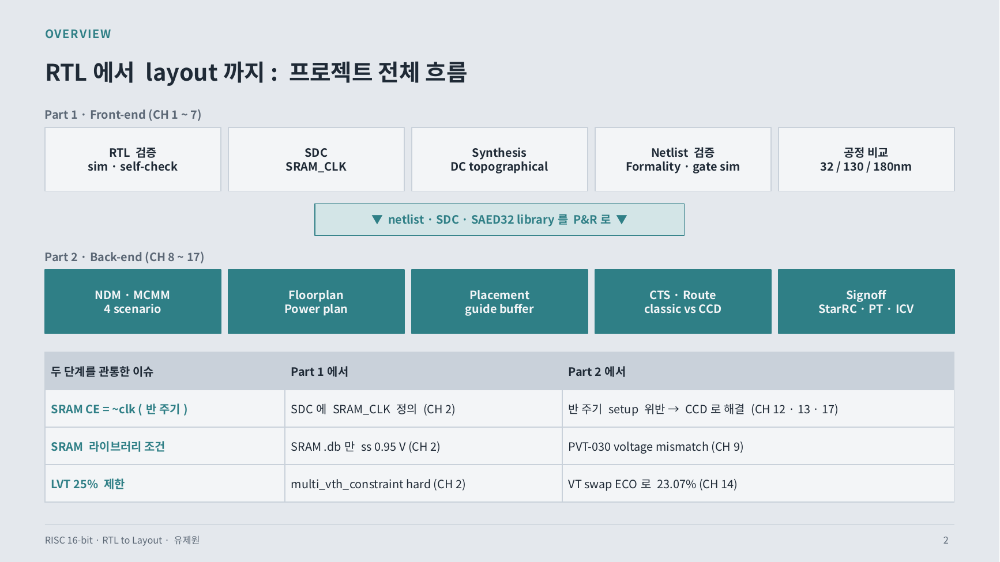
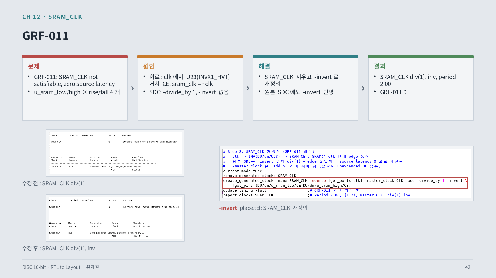
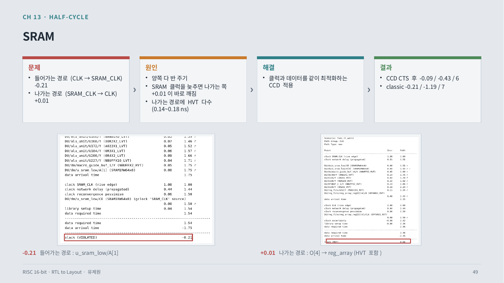
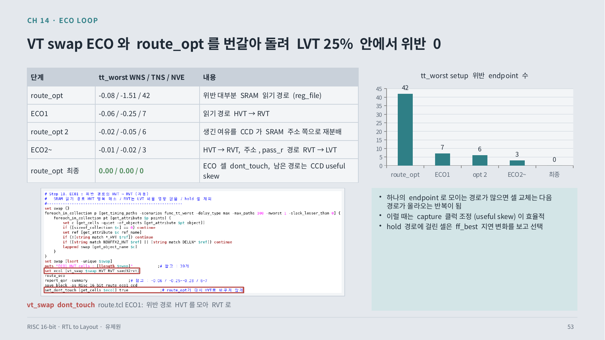
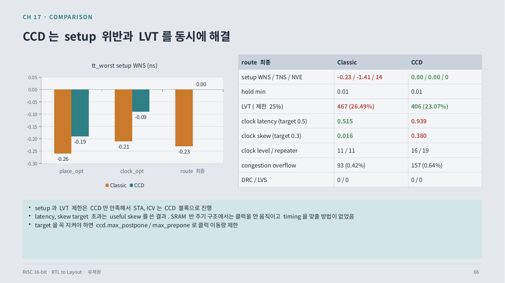
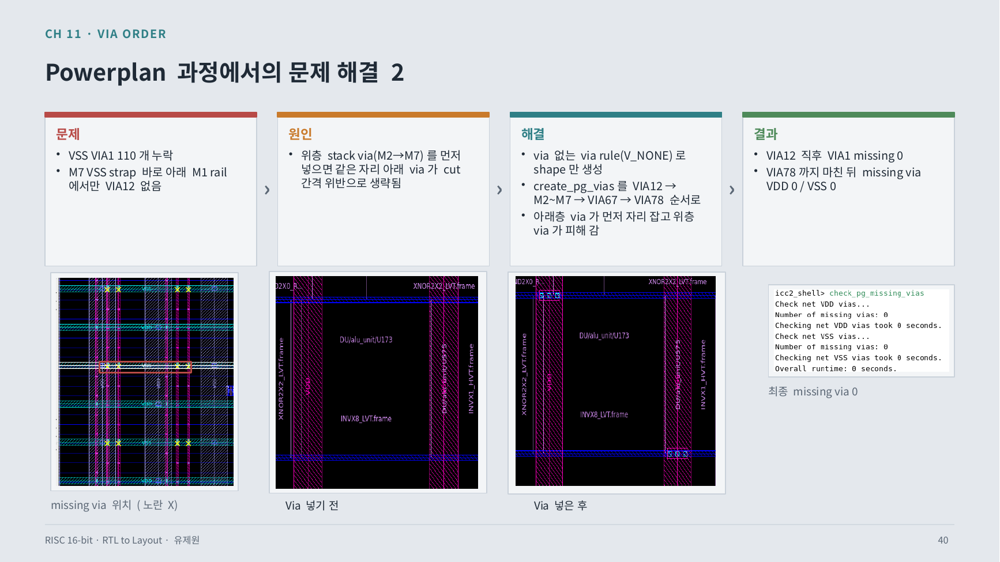

# RISC 16-bit Processor · RTL to Layout

16-bit RISC 프로세서 하나를 **RTL 검증 → DC 합성 → ICC2 P&R → StarRC · PrimeTime · ICV signoff**까지 직접 이어서 진행한 프로젝트입니다.

이 설계의 핵심 난관은 **SRAM 매크로 2개가 반전 클럭(`~clk`)으로 동작한다**는 점이었습니다.
SRAM으로 들어가고 나가는 경로가 모두 반 주기(1.0 ns) 안에 끝나야 해서, 이 구조 하나가 constraint · CTS 방식 · ECO 전략까지 결정했습니다.

📄 **전체 발표 자료: [portfolio.pdf](portfolio.pdf)** (66 slides)

🎓 **수료증: Synopsys RTL to GDSII Program "ASIC Design" (청주대학교, 2026)** · [PDF](certificate.pdf)




---

## Overview

| 항목 | 내용 |
|---|---|
| 설계 | 16-bit 단일 사이클 RISC (Datapath, Control Unit, ALU, 8 × 16-bit 레지스터, ROM) |
| Macro | SRAM1RW64x8 × 2 (16-bit data memory, CE = `~clk`) |
| Clock | 2.0 ns · SRAM 입출력은 반 주기 경로 |
| Library | SAED32 RVT / LVT / HVT, 9 metal |
| 제약 | LVT 셀 25% 이하 · MCMM 4 scenario (tt / ff × best / worst) |
| Tools | VCS, Design Compiler, Formality, ICC2, StarRC, PrimeTime, ICV |

## Results (CCD flow 최종)

| 항목 | 결과 |
|---|---|
| Setup / Hold (route 후) | WNS 0.00 ns / hold min +0.01 ns |
| LVT 비율 | 23.07% (제한 25%) |
| PrimeTime signoff | 4 scenario timing · max cap 위반 0 |
| Physical (ICC2) | check_routes DRC 0 · short / open 0 · PG missing via 0 |

---

## Key Problems & Solutions

### 1. Constraint 오류가 timing 위반을 가리고 있었다 (GRF-011)

- **문제**: P&R 초반부터 `GRF-011: SRAM_CLK not satisfiable` 경고가 계속 남음
- **원인**: SRAM CE 앞에는 인버터가 있는데, 합성 때 작성한 SDC의 `SRAM_CLK`에는 `-invert`가 빠져 있었음
  → SRAM 경로가 **반 주기가 아니라 한 주기(2 ns)로 계산**되어 위반이 보이지 않았음
- **해결**: `-invert`로 SRAM_CLK를 다시 정의하고 원본 SDC도 함께 수정
- **결과**: GRF-011 0, 대신 숨어 있던 setup 위반이 드러남 (ideal clock 기준 -0.51 ns)
- **배운 점**: constraint가 회로와 다르면 timing report는 "통과"로 거짓말을 한다 → 경고는 fanin까지 따라가 회로와 대조



### 2. 반 주기 경로를 classic CTS로는 풀 수 없어 CCD를 선택

- **문제**: SRAM으로 **들어가는** 경로 -0.21 ns, **나가는** 경로 +0.01 ns (둘 다 반 주기)
- **판단**: SRAM 클럭을 늦추면 들어가는 쪽은 좋아지지만 나가는 쪽 +0.01이 바로 깨짐
  → 클럭만 / 데이터만 고치는 방식으로는 안 되고, **클럭과 데이터를 같이 최적화하는 CCD** 선택
- **결과 (CTS 후)**: classic -0.21 ns → CCD -0.09 ns. CCD가 SRAM CE 클럭을 0.44 → 0.62 ns로 늦춰 주소 경로에 시간을 만듦



### 3. LVT 25% 제한 안에서 남은 위반 정리 (VT swap ECO ↔ route_opt)

- route 후 남은 위반 42개는 대부분 SRAM 읽기 경로(reg_file)로 모이는 경로
- 셀을 LVT로 바꾸면 LVT 제한에 걸리므로, **HVT → RVT 위주로 교체**(꼭 필요한 주소 · pass_r 경로만 LVT)하고 `dont_touch`로 고정한 뒤 route_opt를 다시 돌려 CCD가 생긴 여유를 재분배하게 함
- 위반 개수 42 → 7 → 6 → 3 → **0**, LVT 23.07%



### 4. Classic vs CCD 최종 비교: 무엇을 얻고 무엇을 내줬나

| route 최종 | Classic | CCD |
|---|---|---|
| setup WNS / TNS / NVE | -0.23 / -1.41 / 14 | **0.00 / 0.00 / 0** |
| LVT (제한 25%) | 26.49% (초과) | **23.07%** |
| clock latency (target 0.5) | 0.515 | 0.939 |
| clock skew (target 0.3) | 0.016 | 0.380 |

- CCD는 클럭을 일부러 움직여 timing과 LVT를 동시에 맞춘 대신 latency · skew target을 넘김
- 동작(timing)을 우선해 CCD 블록으로 signoff까지 진행. skew target을 지켜야 하는 환경이라면 `ccd.max_postpone / max_prepone`로 클럭 이동량을 제한하는 것이 다음 선택지



### 5. Power plan: via를 넣는 순서 때문에 VIA1 110개 누락

- **문제**: VSS VIA1이 110개 빠짐. 위치는 모두 M7 VSS strap 바로 아래 M1 rail
- **원인**: 위층 stack via(M2 → M7)를 먼저 넣으면, 같은 자리의 아래층 via가 cut 간격 규칙에 걸려 생략됨
- **해결**: via 없는 via rule(`V_NONE`)로 PG shape만 먼저 만들고, `create_pg_vias`를 **아래층부터** (VIA12 → M2 ~ M7 → VIA67 → VIA78) 실행해 아래 via가 먼저 자리를 잡게 함
- **결과**: missing via VDD 0 / VSS 0



---

## Front-end 요약

- **RTL 검증**: self-check testbench (PC 0x14 도달 시 opcode · 명령어 · 다음 PC 비교)로 `done = pass = 1`
- **합성**: DC topographical, check_design 경고는 하나씩 RTL 원인을 찾아 의도된 구조인지 판단
- **Netlist 검증**: gate-level 시뮬레이션에서 RTL과 같은 순서로 `done = pass = 1`
- **공정 비교**: 같은 RTL을 TSMC 130 / 180nm 라이브러리로 재합성해 timing · 면적 · 전력 비교 (상세는 PDF)

## Repository Structure
```
├── README.md
├── portfolio.pdf        # 전체 발표 자료 (66 slides)
└── images/              # README 그림
```

---
유제원 · 2026 KDT CJU
